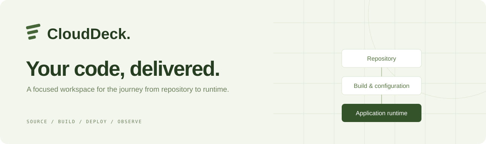

<p align="center"></p>

# CloudDeck

A cloud deployment platform under active development: Next.js workspace, Express control plane, MongoDB records, Redis/BullMQ dispatch and a Docker development runner.

**Release status: engineering review. Public customer onboarding is blocked.** This branch improves real application paths and removes several fabricated success paths. It does not establish Vercel/Render parity or production tenant isolation. Read the [audit](docs/PRODUCT_AUDIT.md), [hosting proposal](docs/HOSTING_PLAN.md) and [verification record](docs/VERIFICATION.md) and [deployment lifecycle review](docs/DEPLOYMENT_LIFECYCLE.md) before deploying.

## Product workspace

- A new CloudDeck identity, responsive navigation and landing page without invented customers or compliance claims.
- API-backed project creation, search, configuration and encrypted environment variables.
- Deployment history, logs, stop/cleanup status, cancellation, retry and commit-based rollback requests, with explicit errors instead of simulated results.
- Email/password sign-in, provider availability, session revocation, email verification and a session-bound one-time OAuth exchange.
- A separate HTTP/WebSocket application gateway, ownership checks on core project/deployment resources and honest readiness signals.

These are implemented paths, not a claim that every legacy screen or integration has been accepted. Organizations/RBAC, isolated execution, managed TLS/custom domains, previews and metered billing remain release gates.

## Local development

Requires Node.js 22+, npm, MongoDB 7, Redis 7 and Docker on a dedicated development machine for actual builds. Use only repositories you own and trust. The development runner controls its host Docker daemon; **do not accept customer code**. It refuses production execution.

```sh
git clone https://github.com/kranthikiran885366/msd-project.git
cd msd-project
npm run install:all
node scripts/configure-local.cjs
docker compose --env-file .env.docker up --build -d
```

Open `http://localhost:3000`. The API is on loopback port 3001; application gateway on loopback port 8080. Configuration generation refuses to replace existing files and generates independent local secrets without printing them. Configure OAuth and SMTP in private provider/settings files; never commit them. Compose is a development topology, not the proposed production infrastructure.

For separate processes, start MongoDB/Redis, run `npm run dev --prefix server`, `npm start --prefix runner-agent`, `node server/gateway.js` with the appropriate private environment, and `npm run dev`. The generated manual-process frontend uses port 5000. Do not mix manual-process and Compose service addresses.

## Verification

```sh
npm run verify
node scripts/smoke-frontend.cjs
MONGOMS_VERSION=7.0.24 npm test --prefix server -- --runInBand
```

`verify` runs lint, TypeScript, unit/transport tests and a strict Next.js production build. The frontend smoke checks HTTP, rendered text and CSS; it does not automate a browser. Server tests start actual disposable MongoDB. See [VERIFICATION.md](docs/VERIFICATION.md) for observed results and blockers.

For a dedicated disposable control plane, see `scripts/smoke-control-plane.cjs`. Explicit record-creation opt-in is required. Deployment mode must reach a real worker and actual application URL. It does not replace the isolation, provider, payment and recovery acceptance suite in the hosting plan.

## Repository map

| Area | Purpose |
| --- | --- |
| `app/`, `components/product/` | Landing, identity and deployment workspace |
| `server/` | API, authentication, persistence and coordination |
| `server/gateway.js` | Application-origin HTTP/WebSocket forwarding |
| `runner-agent/` | Trusted development Docker execution only |
| `tests/unit/`, `server/tests/` | Unit/transport and real-database checks |
| `.github/workflows/verify-product.yml` | Automated verification |
| `docs/` | Architecture, audit, operations and release evidence |

## Contributing and operations

Use a branch and pull request. A UI build does not establish safe hosting. Pin production images by digest, keep secrets in provider settings, review migrations and validate staging before promotion. Report security issues privately to the repository owner; do not put credentials in public issues.

Infrastructure is not provisioned by this change. The hosting plan contains proposed accounts, isolation boundaries, budget and acceptance criteria.
