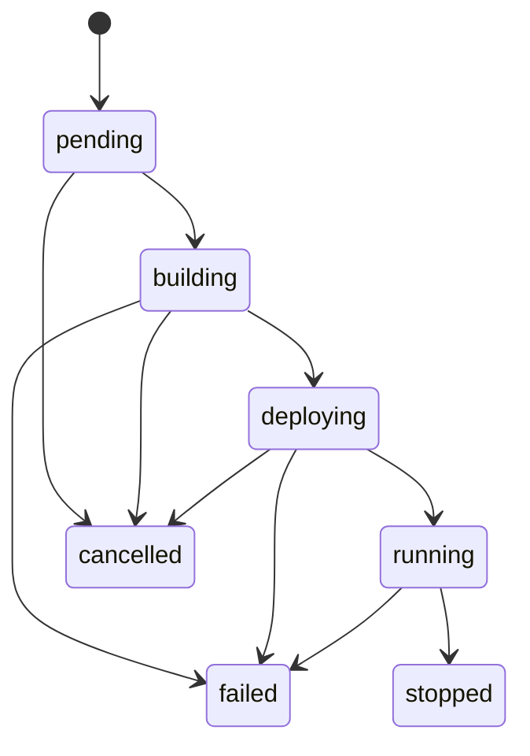

# Deployment lifecycle review

25 November 2026. This extends the draft product changes. It is a source implementation and verification record, **not a claim that cloud E2E or public production acceptance passed**.

## State and resource contract

Terminal states cannot return to building/running. A retry or previous-commit rebuild creates a new deployment. Status, revision and the status audit line use one MongoDB compare-and-swap update. Concurrent cancellation/promotion has one winner; callers receive a conflict rather than overwrite a newer result.

Cleanup is a separate fact: `not-required`, `pending`, `complete` or `failed`. Stopping/cancelling withdraws the route before asynchronous cleanup is confirmed. An existing WebSocket may remain connected until its runtime is removed. A cancellation response does not assert that all infrastructure has disappeared.

## Implemented changes

| Stage | Behavior |
| --- | --- |
| Request/configuration | Validate environment/full commit identity; honor the configured branch; reject unimplemented canary/domain operations explicitly |
| GitHub push | Authenticate exact raw request bytes; reject malformed signatures/repository mismatch; honor configured branch/deploy-on-push; deduplicate commit/ref triggers through a unique project/trigger index |
| Queue | Acknowledge creation after queue insertion; remove completed/failed Redis job payloads because they contain execution credentials; preserve deployment logs/state in MongoDB |
| Worker claim | Atomic one-time claim, random token returned once, hash stored privately; writes/logs/port allocation require this deployment token |
| Build | Clone exact commit, bound root directory, fail unsupported builds; record Docker image ID after successful build; clean a partially failed clone |
| Reservation | MongoDB unique indexes decide port ownership across API instances; retry collisions; bind reservations to the claimed worker; reuse released legacy records |
| Readiness | Running process plus configured HTTP path and separate ingress identity check; running callback requires resolved commit/image and matching port reservation |
| Final acknowledgement | If a success response is lost, read persisted state. Preserve the app when committed running; retain resources for reconciliation if state is unknown |
| Stop/cancel/failure | Explicit stop endpoint; cancelled/stopped/failed route is unavailable; remove runtime/image before cleanup acknowledgement releases its port |
| Worker restart | Private persistent claim journal; interrupted builds are failed and cleaned, never automatically replayed; retain running apps and their journal |
| Runtime supervision | Inspect actual Docker state; preserve resources if daemon state is unknown; withdraw/clean after three consecutive HTTP health failures |
| Project archive | Preserve records/claims instead of deleting deployment records and orphaning runtimes; existing runtimes require explicit stop |
| Previous commit | Select previous success within the same environment, require full commit SHA, preserve environment/caller; respond that rebuild is queued, not that rollback is complete |

The UI now exposes Stop application, cleanup state and health-path configuration. Existing running configurations are snapshots; changes apply to the next deployment.

## Verification

54 local unit/transport checks passed after these changes, including cancellation/promotion races, terminal callbacks, immutable ownership fields, lost success acknowledgement, uncertain state, port collisions/exhaustion/worker binding, exact-byte HMAC, journal permissions/recovery, cleanup retry retention, daemon uncertainty and three-failure health withdrawal. Controlled model/worker dependencies are used in these unit cases; they are not a substituted cloud E2E suite.

Three actual MongoDB cases were added for compare-and-swap races, concurrent port allocation/reuse and webhook identity uniqueness. Together with identity/tenant tests there are 12 database integration tests. Their status and build/HTTP results are recorded in [VERIFICATION.md](VERIFICATION.md). No real Docker deployment, provider credentials, DNS, certificates, payment, cloud isolation or restore test has passed in this workspace.

## Upgrade and operation

Deploy API and worker together in a dedicated development/staging environment. The old worker has no claim token and its callbacks are intentionally refused by the new API. Drain it and inventory its containers/ports before upgrading; do not delete unknown resources automatically.

Startup waits for deployment/port indexes. Review the new unique partial `{projectId, triggerKey}` index against actual data before production migrations. Keep the existing unique deployment/port indexes; reservations are removed only after confirmed cleanup, freeing the unique port. These reservations are globally conservative and are not a multi-region scheduler.

The Compose worker now has a persistent `worker-state` volume at `/var/lib/clouddeck-worker`. For a manual worker, provide a private writable `WORKER_STATE_DIR`. Journal files contain claim credentials: restrict access, exclude from artifacts/logs and retain across worker replacement. Losing the journal or changing a worker node identity requires operator reconciliation; it is not safe to guess ownership or silently replay builds. Back up/restore it with the corresponding worker's runtime metadata, never to another active worker concurrently.

Poll-based supervision currently runs every 15 seconds on the owning worker. If that entire host disappears, cleanup cannot be confirmed; reservations and records remain for operator reconciliation. There is no cross-account cloud orphan sweeper yet. A control-plane outage preserves runtime/journal rather than making destructive guesses.

## Remaining production gates

- Shared-Docker execution remains **disabled in production** and limited to operator-owned development code. The journal/supervisor does not create tenant isolation.
- Durable outbox dispatch and cloud-level orphan reconciliation are still needed for crashes before queue insertion or before a claim journal is persisted.
- Previous-commit rebuild is not immutable registry-artifact rollback. Registry retention, runtime placement and atomic service route promotion remain unimplemented.
- Custom domains/managed TLS, protected PR previews, durable schedules and cache metadata endpoints fail explicitly where unsupported; no synthetic success records are returned.
- Scoped GitHub App installation identity and secret-free fork previews remain outstanding. Verified GitHub push handling is not a completed GitHub App integration.
- Real staging tests must cover image build/start/HTTP/WebSocket, failure/cancellation at each phase, stop, restart, simultaneous tenants, actual port reuse and external HTTPS. The hosting proposal must be approved before paid resources are provisioned.

See [HOSTING_PLAN.md](HOSTING_PLAN.md) for the infrastructure and acceptance plan.
