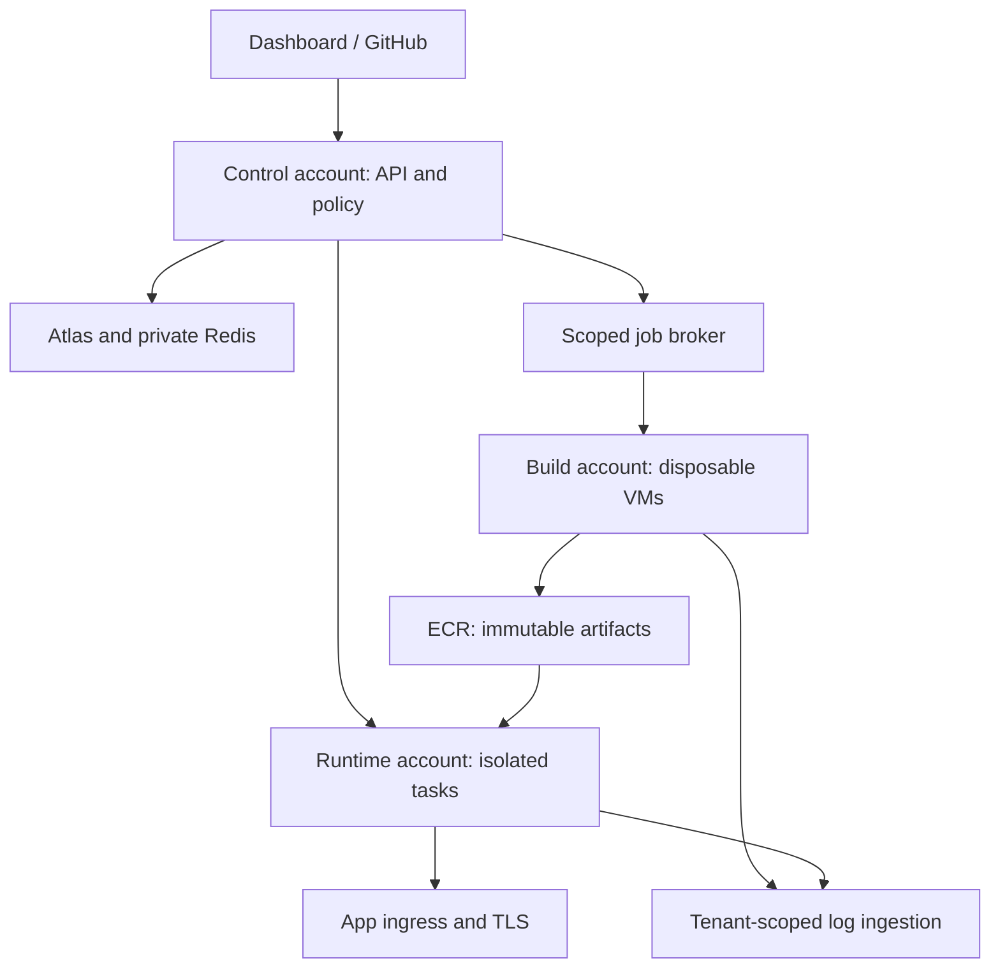

# CloudDeck production hosting and implementation proposal

25 November 2026. **Architecture/budget review only. No paid infrastructure has been provisioned by this change.** Target: a genuine customer-facing hosting platform. The current repository is not yet that release.

## Recommended providers

Use AWS for execution infrastructure and MongoDB Atlas for the managed application database. Start in Mumbai (`ap-south-1`), subject to regional availability, data requirements and a calculator quote. Separate control, build and customer runtime into different AWS accounts under one organization. Start one region across two availability zones; do not claim active-active multi-region.

Render can host a transitional control plane and orchestration worker through a reviewed Blueprint. It must not run the existing shared-Docker executor. Render documents image builds and image-based services; this does not establish a user-controlled host daemon or a tenant isolation boundary. A Render worker could submit jobs to isolated infrastructure without running customer code. The recommended final AWS control account simplifies private networking, IAM and cost attribution. Avoid two simultaneously authoritative control planes during migration.

Kubernetes is unnecessary for the initial release. ECS/Fargate is the proposed runtime: AWS documents task-level isolated capacity and no privileged/Docker-in-Docker access. It requires a real adapter and acceptance tests; it cannot run our existing Docker worker unchanged. Disposable EC2 build guests are proposed for builds. CodeBuild is an alternative requiring its own IAM/privilege/hostile-build review, not an assumed secure drop-in.

## Architecture and trust boundaries

The control plane authorizes desired state; it never runs customer shell commands. Builds publish artifact digests; they cannot promote routes. A runtime reconciler deploys a digest, probes actual health and atomically promotes a routing revision. Events carry organization/project/deployment, actor, commit and artifact identities.

### Control plane

- Next.js frontend and two stateless APIs behind HTTPS. Require verified identity and enforce organization roles for every resource.
- Atlas replica-set deployment with production backup/PITR sized for connection/data load; staging has separate cluster/users. Least-privilege DB users and private connectivity where supported.
- Private encrypted Redis-compatible queue with persistence and noeviction. Validate TLS, scripts and BullMQ compatibility against the selected engine/version.
- Durable Mongo outbox, unique request/deployment identities, dispatcher and reconciler. Redis is not the only deployment record. Recover orphaned work after outages; do not equate delivery deduplication with exactly-once external effects.
- KMS/Secrets Manager for long-lived secrets. GitHub Actions OIDC with narrow, environment-specific roles and protected production promotion; no static cloud access keys in GitHub.
- Authoritative deployment and organization quotas checked before infrastructure calls; explicit desired, actual, failed and reconciling states.

### Isolated builds

- One disposable EC2 VM per deployment, hardened image and local builder daemon. Customer Dockerfiles may control the guest; the VM is the isolation boundary. Never mount a persistent worker's Docker socket into customer execution.
- No guest instance IAM role, DB/Redis credentials, control tokens, other-tenant directories or cross-tenant caches. Block metadata access. The trusted launcher lives outside the guest.
- Trusted broker resolves the GitHub installation and exact commit, then supplies single-build source and artifact grants limited to one deployment prefix and short expiry. Assume the guest can steal any deliberately supplied grant. It cannot overwrite another artifact or promote a production route.
- Build CPU/RAM/disk/PID/time/egress/concurrency limits. Egress policy blocks private/control networks, metadata, link-local, SMTP abuse and DNS rebinding paths while deliberately allowing required package access. Artifact paths and digest manifests are validated outside the guest.
- External controller terminates expired/disconnected VMs, revokes grants and sweeps orphaned disks/interfaces. Never rely on guest self-cleanup. Logs use rate/size-limited, deployment-scoped write-only ingestion.

### Customer runtimes

- Separate account/VPC, one Fargate task per tenant service instance. Never put two tenants inside a task. No customer task IAM role, privileged mode, host mounts or administrative exec.
- Non-root/minimal capabilities, read-only root where compatible, bounded ephemeral storage and explicit CPU/memory. Separate build and runtime secrets, scoped to one project/deployment with KMS-backed encryption and rotation.
- Deny tenant-to-tenant private traffic and direct access to control administration, Atlas and Redis. Public control APIs still require strong authorization; private VPC boundaries do not protect publicly reachable endpoints by themselves.
- Reconciler handles provider throttling, task crashes, draining, capacity and quotas. A running process is insufficient: external ingress must prove the right deployment is healthy before traffic promotion.

### Artifacts, static hosting, ingress and SSL

- ECR immutable tags, digest-addressed records, scan policy, signed provenance/SBOM and retained rollback artifacts. Build identities cannot delete rollback images; runtime pull identities cannot push.
- Static output in private tenant/deployment S3 prefixes behind CloudFront origin access control. Validate paths/content types. Private previews require edge authorization, not merely unguessable URLs.
- Horizontally scaled HTTP/WebSocket application gateway with scoped service discovery, routing revisions, bounded connections/timeouts, tenant rate limits and health/drain handling. Extend the existing transport rather than treating it as an accepted fleet router.
- Separate registrable application domain from the control dashboard. No dashboard cookies on customer hosts and no untrusted HTML served on the control origin.
- Platform wildcard TLS and custom-domain certificates through ACM/managed edge integration. Enforce TXT ownership and uniqueness before routing/issuance; handle CAA failures, renewals, removals, quotas and stale-DNS takeover. DNS verification alone is not a working custom domain.

## Environments and automated provisioning

| Environment | Requirements | Access/lifecycle |
| --- | --- | --- |
| Development | Local MongoDB/Redis, trusted Docker runner | Loopback ports; generated private secrets; no customer code/data |
| Staging | Separate account set/VPCs, Atlas project, Redis, ECR/S3, two AZ subnets, disposable builders | Same isolation policy as production, smaller capacity; separate OAuth/domains/payment sandbox; authenticated access and teardown |
| Production | Separate control/build/runtime accounts, two API replicas, HA DB/queue, private networking and runtime fleet | Protected CI, reviewed plan, on-call access, backups and recovery drills |

Do not copy production data into staging without reviewed anonymization. Encrypt/version infrastructure state, backups and artifacts with environment-specific access. Keep actual credentials only in secure provider settings.

Implement Terraform modules for OIDC/IAM, VPC/egress, KMS/secrets, registry/storage, control services, queue, build launcher, runtime reconciler, DNS/edge and observability. Separate remote state with locking and access roles per environment, provider lockfiles and reviewed plans. Reference secret identifiers rather than committed values; state remains sensitive even if outputs are hidden.

These modules **do not yet exist**. Do not substitute empty modules or an untested production Compose file. First validate a staging vertical slice, then reuse the reviewed modules for production.

CI/CD: clean install → lint/type/unit/real-DB tests → dependency/secret/image scans → digest-pinned images → reviewed staging infrastructure plan/apply → migrations → real acceptance → reviewed production plan → same-digest promotion. Application rollback switches routes; irreversible data migrations require forward recovery/expand-contract changes.

## Implementation order and exit criteria

| Priority | Work package | Evidence required |
| --- | --- | --- |
| P0 | Close unsafe legacy routes; organization membership/RBAC | Owner/admin/developer/viewer/billing roles, revoked membership, cross-org IDs on every resource/socket room, server audit events |
| P0 | Broker, outbox and disposable build adapter | Hostile build cannot reach sockets/platform/other-tenant secrets; timeouts, duplicate work and orphan cleanup tested |
| P0 | Registry, runtime adapter and reconciler | Real static/Node/Dockerfile builds, digest agreement, external HTTP/WebSocket, crash recovery, quotas and deletion |
| P1 | GitHub App + automatic previews | Install/revoke and private repo scope, raw-body webhook signature/replay tests, push deployments, PR lifecycle/cleanup; fork previews get no secrets |
| P1 | Env lifecycle + artifact rollback | KMS versions/rotation, redaction, exact retained-digest rollback without rebuild; atomic health-gated routing |
| P1 | Custom domains + automatic SSL | Public DNS, actual HTTPS, renewal/errors, duplicate claim rejection, removal/reclaim/takeover tests |
| P1 | Monitoring + scaling | Real CPU/memory/request/log metrics, load test, min/max replicas, unhealthy route withdrawal, cost/abuse limits |
| P1 | Metering + payments | Trusted runtime/build seconds and bytes, immutable deduplicated ledger, sandbox invoice reconciliation/refund/failure handling |
| P2 | Recovery + launch | Actual isolated restore, registry/key recovery, incident exercise, closed P0/P1 findings; invite-only paid pilot before broad launch |

Migrate existing owner projects into personal organizations without silently granting membership. Carry organization identity in records, queues, metrics and events. Route authentication alone is insufficient.

Billing must derive subscription state from confirmed signed provider events, not local success assumptions. Deduplicate provider event IDs; only trusted platform meters record usage. Use integer units/minor currency units, price versions and correction events. Confirm merchant availability, company jurisdiction and tax requirements before real charges. No checkout or usage success screen until authoritative state confirms it.

## Monthly cost estimate

**Engineering allowances, not provider quotes.** USD, 730 hours/month, pay-as-you-go, no credits/commitment discounts; excludes tax, staff/support salaries and domain purchase. Checked against official pages on 25 November 2026. Mumbai pricing/network choices need a calculator quote before approval. Staging and production totals are additive; reserve 20% contingency.

Planning load: staging 100 builds × 5 minutes, two small test runtimes, ~20 GB public transfer/month. Production pilot 1,000 builds × 5 minutes, 20 small always-on runtimes, ~100 GB transfer, 50 GB images/assets and 30-day operational logs. These are assumptions, not capacity guarantees.

| Monthly component | Staging | Production pilot | Driver |
| --- | ---: | ---: | --- |
| Control compute | $35–70 | $100–200 | Replicas and requested CPU/RAM |
| Atlas and backup | $15–60 | $120–250 | Tier/region, PITR and connectivity |
| Redis-compatible queue | $15–35 | $60–140 | Memory and HA |
| Disposable builds/storage | $15–45 | $50–150 | VM minutes, disks, failed jobs |
| Customer runtimes | $20–50 | $350–650 | 2 staging / 20 production small tasks |
| Ingress/NAT/endpoints/DNS/IPv4/transfer | $65–140 | $180–400 | AZs, hours, bandwidth and edge |
| Registry/assets/backups | $5–15 | $15–60 | Retention, requests, replication |
| Telemetry/secrets/email/security | $20–35 | $70–150 | Ingestion, scans, keys, sends |
| **Base total** | **$190–450** | **$945–2,000** | Estimated, workload dependent |
| **With 20% contingency** | **$228–540** | **$1,134–2,400** | Proposed planning envelope |

Recalculate totals as architecture is selected; larger HA tiers, private endpoints or verbose logs can exceed these allowances. These are small-pilot budgets, not enterprise SLA pricing. More tenants, high bandwidth, persistent volumes, attacks and domain/certificate quotas materially change costs. Build per-tenant gross-margin models before advertising plans. Budget alerts are not hard caps: enforce admission, maximum replicas/build concurrency and log retention.

Official anchors: Render lists a 1 CPU/2 GB service at $25/month; Atlas dedicated clusters start at $56.94/month, varying by region/configuration. Neither is a complete platform bill. Fargate charges for requested resources over task duration plus associated networking/logging. Do not use a universal per-app price or assume a free shared database supplies production HA.

## Real staging acceptance runbook

1. Approve account ownership, region, domain ownership and staging budget; review infrastructure plan. Apply without production data or credentials.
2. Run clean installs, root verification and actual MongoDB tests. Deploy digest-pinned control images; verify HTTPS, mail, OAuth sessions, rate limits and cross-tenant denial.
3. Deploy known static, Node backend and Dockerfile services from exact GitHub commits. Verify job logs, artifact digest, external HTTP/WebSocket and resource consumption. Unsupported builds fail honestly.
4. Test install/build/start/health failure; cancellation at each phase; callback duplication/reordering, queue outage, worker crash/restart and orphan cleanup. Verify no false running states or leftover charged resources.
5. Run two independent organizations with hostile build/runtime probes against metadata, host files, sockets, private networks, DNS rebinding and credential exfiltration. Independent security review before customer code.
6. Exercise GitHub push/PR lifecycle, exact artifact rollback, env rotation, custom domain HTTPS and certificate errors. Revoke installations/memberships and verify access stops.
7. Reconcile a known workload with payment sandbox/usage ledger. Load test scaling/spend limits. Restore backups into an isolated environment and measure recovery.
8. Record commit/image/plan identities, timestamps, request IDs, sanitized logs, outcomes and cleanup inventory. Fix root causes and rerun failed checks. Blocked/skipped is never a pass.

## Observability and disaster recovery

Initial design objectives, to validate: 99.9% monthly control API availability, DB RPO 15 minutes and control-plane RTO four hours. They are not promised SLAs. Customer uptime depends on replicas/plan. Do not publish compliance/SLA badges without evidence and contractual review.

Structured logs/OpenTelemetry carry tenant/project/deployment trace IDs and exclude auth headers, secrets and source bodies. Alert on queue age, leases/orphans, readiness/error rates, cert expiry, webhook failures, runtime saturation, ledger lag and abnormal spend. Separate audit retention from debug logs, with named incident/on-call ownership.

Enable tier-appropriate Atlas PITR/backups, backup verification and quarterly actual restore drills. Encrypt/version state, registry and object data; production deletion protection/retention. Document key recovery and account-compromise, lost-queue, leaked-build-grant, bad-promotion, DB-loss and region-outage procedures. Initial regional recovery is restore/redeploy, not untested active-active.

## Paid provisioning checkpoint

Review account/billing ownership, Mumbai versus alternative region, selected staging envelope, production estimate, domains, secure secret locations and exact Terraform plan before any paid apply. Staging approval does not approve production or public onboarding. Never paste credentials into chat, Git or logs.

## Official sources checked

- [Fargate isolation/limitations](https://docs.aws.amazon.com/AmazonECS/latest/developerguide/fargate-security-considerations.html)
- [ECS shared responsibility](https://docs.aws.amazon.com/AmazonECS/latest/developerguide/security-shared-model.html)
- [Fargate pricing](https://aws.amazon.com/fargate/pricing/)
- [CodeBuild pricing](https://aws.amazon.com/codebuild/pricing/)
- [CodeBuild compute modes](https://docs.aws.amazon.com/codebuild/latest/userguide/build-env-ref-compute-types.html)
- [ElastiCache pricing](https://aws.amazon.com/elasticache/pricing/)
- [MongoDB Atlas pricing](https://www.mongodb.com/pricing)
- [Render pricing](https://render.com/pricing)
- [Render Docker documentation](https://render.com/docs/docker)
